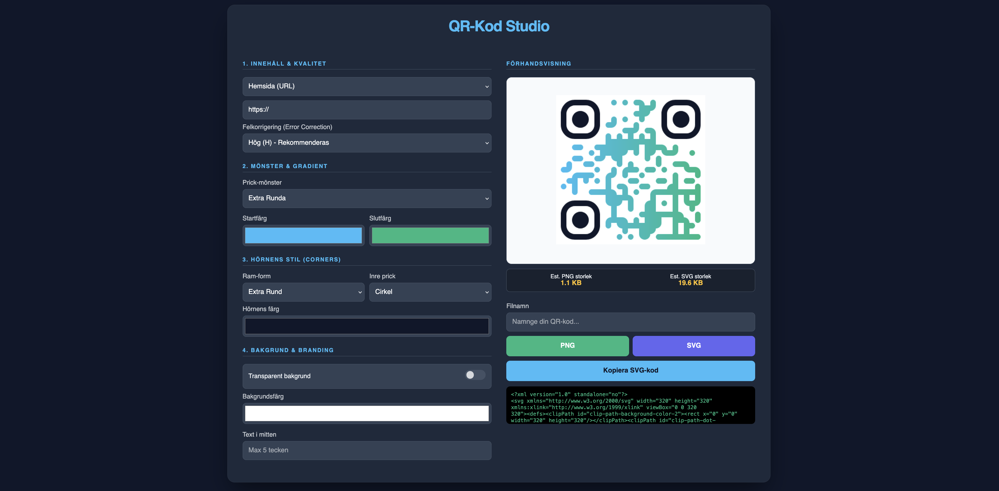

# QR Studio

Skapa hur många gratis QR-koder du vill för URL, WiFi, SMS, GPS, och telefonnummer. Välj mellan olika mönster, färger, bakgrund m.m. Spara QR-koden som PNG-bild eller SVG. Använder `html2canvas.js`
